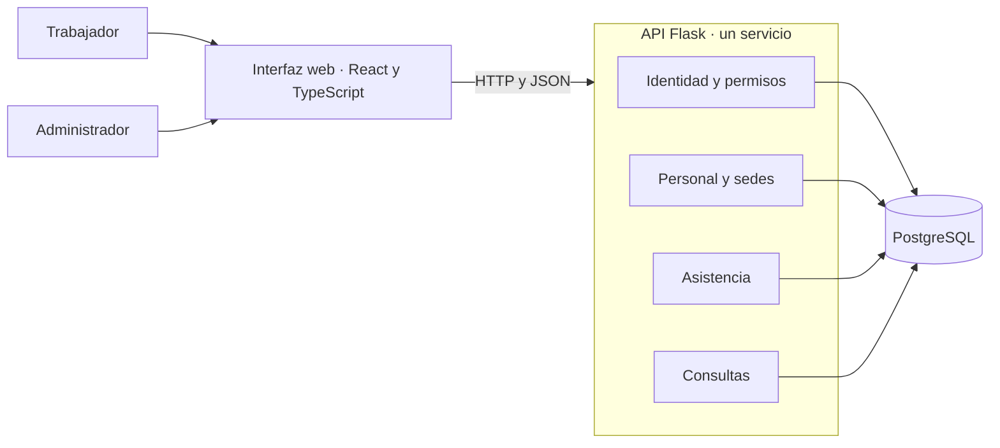
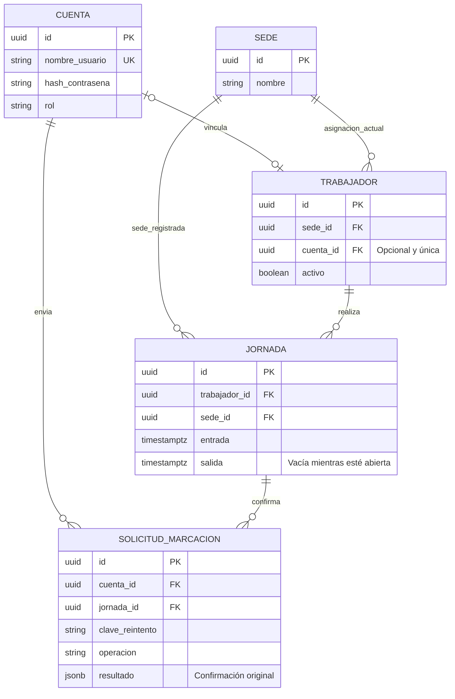
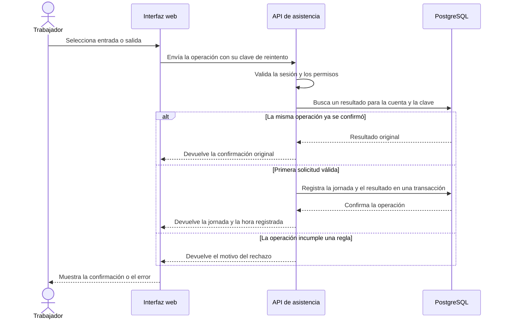

# Arquitectura del MVP

La base actual conecta React, Flask y PostgreSQL. Los diagramas muestran el diseño previsto para incorporar el [flujo de asistencia](casos-de-uso.md). Cada instalación atiende a una empresa con varias sedes y su propia base de datos.

## Componentes

**Identidad** autentica con nombre de usuario y contraseña y valida la sesión y el rol. **Personal y sedes** mantiene los trabajadores y su asignación vigente. **Asistencia** abre y cierra jornadas. **Consultas** obtiene el historial según los permisos del actor. Las rutas de Flask traducen las solicitudes HTTP y llaman al módulo responsable.

## Modelo de datos propuesto

La sede de la jornada se registra al abrirla. El estado se puede derivar de la hora de salida. PostgreSQL puede imponer una sola jornada abierta por trabajador mediante un índice único parcial sobre las jornadas cuya salida esté vacía. El registro de una marcación exitosa y el resultado asociado a su clave de reintento deben confirmarse en la misma transacción.

## Secuencia de marcación

Si la respuesta se pierde, la interfaz conserva la clave para repetir la misma operación. El modelo es conceptual. La primera migración concretará los nombres, tipos y restricciones de las tablas.
