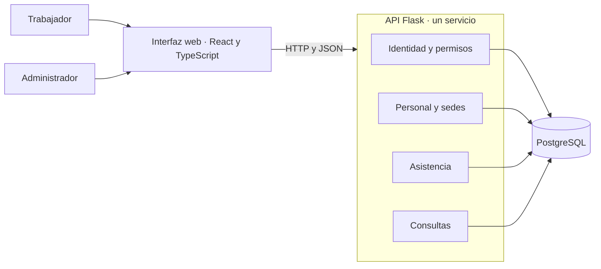
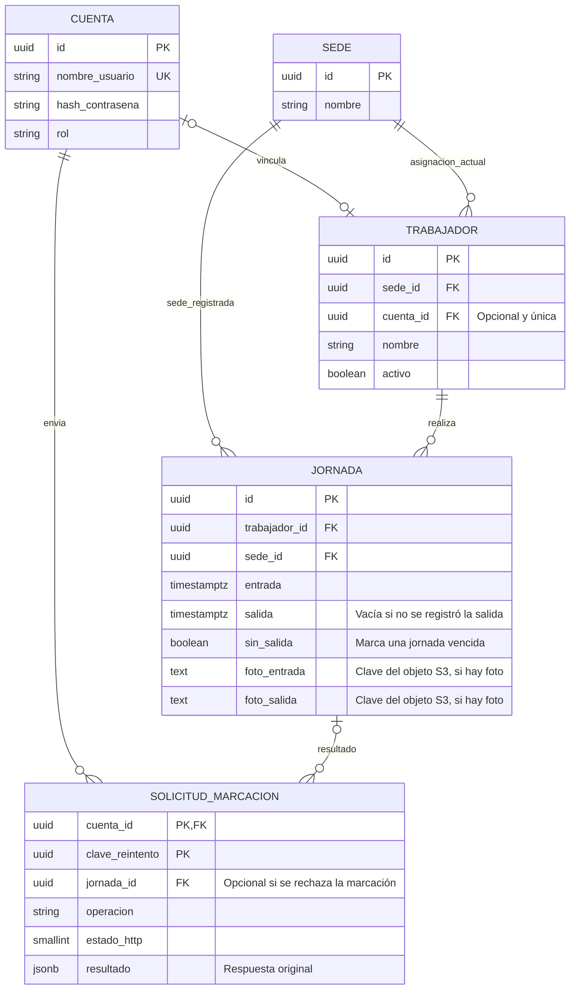
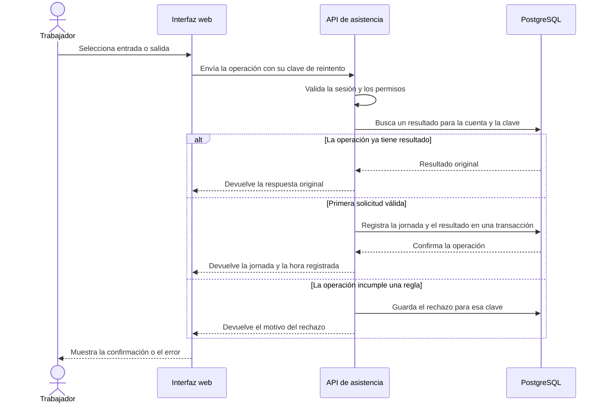

# Arquitectura del MVP

La base actual conecta React, Flask y PostgreSQL. Los diagramas muestran el diseño previsto para incorporar el [flujo de asistencia](casos-de-uso.md). Cada instalación atiende a una empresa con varias sedes y su propia base de datos.

## Componentes

**Identidad** autentica con nombre de usuario y contraseña y valida la sesión y el rol. **Personal y sedes** mantiene los trabajadores y su asignación vigente. **Asistencia** abre y cierra jornadas. **Consultas** obtiene el historial según los permisos del actor. Las rutas de Flask traducen las solicitudes HTTP y llaman al módulo responsable.

## Modelo de datos de marcación

La sede de la jornada se registra al abrirla. Las consultas muestran **Sin salida** para una jornada anterior al día actual que sigue sin hora de salida. Antes de procesar una nueva marcación o una desactivación, el servicio bloquea la fila del trabajador y marca como vencida su jornada pendiente de un día anterior. La misma transacción comprueba el límite de una entrada por día y conserva el resultado de la solicitud. El índice único parcial permite una sola jornada pendiente por trabajador y excluye las jornadas marcadas sin salida.

## Secuencia de marcación

Si la respuesta se pierde, la interfaz conserva la clave para repetir la misma operación. La [primera migración](../backend/migrations/versions/20261112_0001_crear_tablas_de_asistencia.py) crea las tablas y el índice de jornadas abiertas.

En una instalación con S3, la API comprueba la jornada y los permisos antes de subir la foto. Luego guarda su clave junto con la marcación y el resultado del reintento en PostgreSQL. La clave en S3 depende de la cuenta, la solicitud y la imagen normalizada. Esto permite recuperar una carga previa si se pierde la respuesta de S3. Si PostgreSQL no confirma la transacción después de una carga exitosa, la foto puede quedar sin referencia hasta que se reintente con el mismo archivo. El acceso al objeto requiere un enlace temporal emitido tras verificar el acceso a la jornada.
